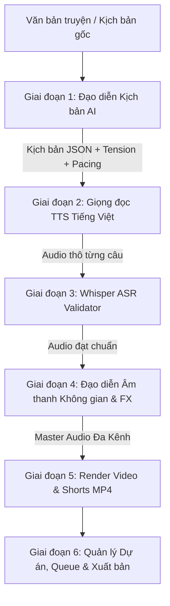

# SPECIFICATION: VODIE - AI Horror Audio & Video Production Studio
*(Studio Tự Động Hóa Sản Xuất Truyện Ma & Podcast Kinh Dị AI)*

---

## 1. TỔNG QUAN HỆ THỐNG (SYSTEM OVERVIEW)

**VODIE** là giải pháp phần mềm chuyên sâu nhằm tự động hóa quy trình sản xuất truyện ma, truyện kinh dị và podcast rùng rợn từ văn bản đầu vào cho đến sản phẩm hoàn thiện (Audio đa tầng âm thanh không gian 3D, Video MP4 YouTube 16:9 kèm sóng âm & phụ đề cháy chữ, Video TikTok/Shorts 9:16).

Ứng dụng được thiết kế theo mô hình **Đạo diễn AI (AI Director Engine)** kết hợp với chuỗi xử lý âm thanh kỹ thuật số (DSP) và công cụ dựng hình đa phương tiện (FFmpeg).

---

## 2. KIẾN TRÚC 6 GIAI ĐOẠN CỐT LÕI (CORE STAGES)

---

### Giai đoạn 1: Đạo diễn Kịch bản AI (Script Analysis & Director)
- **Phân tách câu và gán vai:** Tự động nhận diện Người dẫn chuyện (Narrator), Nhân vật chính, Nhân vật phụ, Hồn ma/Thực thể tâm linh.
- **Thang điểm căng thẳng (Tension Scale 0–10):** Chấm điểm độ nghẹt thở cho từng phân đoạn kịch bản.
- **Gắn nhãn đạo diễn (Director Cue Markers):**
  - Gắn vị trí không gian cho âm thanh (`panning`: left, right, rear, moving).
  - Gắn điểm ngắt nghỉ (`pause_duration`: 0.5s – 3.0s).
  - Gắn điểm Jump scare và hiệu ứng âm thanh (SFX).
- **AI Viết truyện từ ý tưởng (Tùy chọn):** Nhập gợi ý ngắn (vd: *"ngôi nhà hoang ở Đà Lạt"*) -> AI sinh kịch bản hoàn chỉnh theo cấu trúc 3 hồi kinh dị.

---

### Giai đoạn 2: Hệ thống Giọng đọc & Ngữ âm Tiếng Việt (Vietnamese Multi-Voice TTS)
- **Đa dạng vùng miền:** Lựa chọn linh hoạt giọng Bắc, giọng Nam, giọng Trung cho người dẫn và từng nhân vật.
- **Thư viện Voice Cloning:** Quản lý mẫu giọng đã sao chép, phân loại và lưu trữ an toàn.
- **Từ điển phát âm tùy chỉnh (`pronunciation_dict.yaml`):**
  - Chuẩn hóa tên riêng, địa danh (vd: *"Út Lụa"*, *"Thất Sơn"*).
  - Chuẩn hóa từ lóng, tiếng Anh (vd: *"creepypasta"*, *"jump scare"*).

---

### Giai đoạn 3: Kiểm định Phát âm Tự động (Whisper ASR Validation)
- **So khớp giọng đọc thực tế với văn bản gốc:** Sử dụng mô hình OpenAI Whisper để nghe lại từng câu audio vừa tạo ra.
- **Tính toán tỷ lệ sai sót (WER / CER):** Nếu phát hiện nuốt chữ, ngọng hoặc đọc lệch nghĩa:
  - Tự động re-take (đọc lại) tối đa 2 lần với các seed âm thanh khác nhau.
  - Nếu vẫn không đạt, hệ thống tự động đánh dấu cảnh báo để người dùng can thiệp thủ công.

---

### Giai đoạn 4: Đạo diễn Âm thanh Không gian & Hiệu ứng Rợn Tóc Gáy (Horror FX & Spatial Audio)
- **Âm thanh không gian (Binaural 3D / Stereo Panning):**
  - Chuyển động thì thầm lướt từ tai trái sang tai phải.
  - Tiếng bước chân, tiếng thở dài phía sau lưng.
  - Tối ưu hóa cho chế độ *"Nghe bằng tai nghe"*.
- **Jump scare có kiểm soát an toàn:**
  - Quy tắc im lặng tuyệt đối 1–2 giây để tạo cảm giác nín thở, sau đó kích hoạt SFX rùng rợn bất ngờ.
  - Bộ giới hạn âm lượng True Peak (Safe Peak Limiter) khống chế mức tối đa **-1 dBTP**, chống gây hại thính giác. Có *"Chế độ dịu tai"* cho người nhạy cảm.
- **Nhịp độ tự co giãn (Dynamic Pacing):**
  - Mở đầu truyện đọc chậm rãi, tạo không khí u ám.
  - Đoạn gay cấn (Tension cao) đẩy nhanh tốc độ, câu ngắn dồn dập.
  - Câu chốt hạ ngắt quãng dài, tạo dư âm ám ảnh.
- **Preset giọng ma (`voice_presets.yaml`):**
  - `ma_nu`: Thì thầm, reverb lớn, tăng cao độ (pitch +).
  - `quy_du`: Trầm sâu (pitch -), méo tiếng (light distortion).
  - `vong_hon`: Vang vọng từ xa (echo xa, lowpass filter).
- **Hệ thống Mood:** `nhe_nhang`, `kinh_di_nang`, `tam_linh_dan_gian`, `creepypasta` quyết định nhạc nền (BGM), nhịp độ và tần suất SFX.

---

### Giai đoạn 5: Render Audio Đa Tầng & Xuất Video Đăng Mạng (Multi-Track Mixer & Video Studio)
- **Multi-track Mixer:** Trộn track giọng nói, track nhạc nền (tự động Auto-Ducking khi có giọng nói) và track SFX không gian.
- **Xuất Video MP4 YouTube (16:9):**
  - Ảnh nền tối rùng rợn (người dùng chọn hoặc thư viện mặc định).
  - Sóng âm chuyển động (Dynamic Audio Waveform Visualizer).
  - Phụ đề cháy chữ theo nhịp đọc (FFmpeg Subtitles).
- **Tự động cắt Shorts/TikTok/Reels (9:16):**
  - Trích xuất tự động phân đoạn 30–60 giây có chỉ số Tension cao nhất.
  - Cắt khổ dọc 9:16, chèn phụ đề nổi bật và nhãn hook giật gân.
- **Intro / Outro kênh tự động:** Lời chào mở đầu, giới thiệu kênh và kêu gọi đăng ký ở cuối truyện.
- **Chia chương truyện dài:** Tự động cắt chương và xuất sách nói định dạng M4B kèm Chapter Markers.

---

### Giai đoạn 6: Giao diện, Quản lý Dự án & Đóng gói (UI, Queue, Packaging & Safety)
- **Quản lý dự án SQLite:** Lưu trữ kịch bản, lịch sử chỉnh sửa từng phiên bản (version history).
- **Hàng đợi xử lý hàng loạt (Batch Queue):** Nhận 10+ truyện cùng lúc, chạy nền qua đêm, có khả năng resume nếu máy bị gián đoạn.
- **Đóng gói Windows Executable (.exe):** Đóng gói trọn gói qua PyInstaller, người dùng không cần cài đặt môi trường code.

---

## 3. TÍNH NĂNG NÂNG CAO (ADVANCED CAPABILITIES)

### Trải nghiệm kinh dị
- **Âm thanh không gian (binaural/stereo panning):** Đạo diễn AI gắn vị trí (trái/phải/sau/di chuyển) cho tiếng thì thầm và SFX; có chế độ *"Nghe bằng tai nghe"*.
- **Jump scare:** Im lặng 1–2s rồi SFX đột ngột; giới hạn peak -1 dBTP, có tùy chọn *"chế độ dịu tai"* giảm cường độ.
- **Nhịp độ động:** Tốc độ đọc và độ dài ngắt nghỉ thay đổi theo mức căng thẳng (tension 0–10) của từng đoạn do đạo diễn AI chấm.
- **Preset giọng ma:** `ma_nu` (thì thầm, reverb, pitch +), `quy_du` (pitch -, distortion nhẹ), `vong_hon` (echo xa, lowpass). Cấu hình trong YAML, dễ thêm preset mới.
- **Mood cho cả truyện:** `nhe_nhang` / `kinh_di_nang` / `tam_linh_dan_gian` / `creepypasta` → ảnh hưởng nhạc nền, nhịp độ, mật độ SFX.

### Chất lượng tiếng Việt
- **Từ điển phát âm tùy chỉnh (file YAML):** Tên riêng, từ địa phương, từ tiếng Anh.
- **Kiểm tra tự động bằng Whisper (bản phù hợp với hạng máy):** So sánh chữ đọc ra với văn bản, câu sai > ngưỡng thì tự đọc lại tối đa 2 lần, còn sai thì đánh dấu cho người dùng xem.
- **Chọn giọng Bắc/Nam** cho người kể và từng nhân vật.

### Xuất bản nội dung
- **Xuất MP4:** Ảnh nền (người dùng chọn hoặc mặc định tối), sóng âm động, phụ đề cháy chữ (ffmpeg).
- **Tự cắt bản short 30–60s, khổ 9:16**, từ đoạn có tension cao nhất.
- **Intro/outro tùy chỉnh** theo tên kênh.
- **Truyện dài:** Tự chia chương, xuất M4B có chapter markers.

### Tiện ích
- **Hàng đợi xử lý hàng loạt**, chạy nền, tiếp tục được nếu tắt máy giữa chừng.
- **Thư viện giọng:** Lưu, đặt tên, nghe thử, xóa giọng đã clone.
- **Lưu dự án (SQLite)** + lịch sử phiên bản kịch bản.
- **Tùy chọn AI viết truyện** từ ý tưởng ngắn, chọn độ dài và mood.
- **Đóng gói Windows .exe** (PyInstaller hoặc tương đương) kèm trình cài đặt.

### An toàn & Bản quyền
- **Khi clone giọng:** Bắt buộc tích xác nhận có quyền sử dụng giọng đó.
- **Ghi metadata "AI-generated"** vào file audio/video xuất ra.
- **Thư mục assets chỉ chứa nhạc/SFX miễn phí bản quyền**, kèm file ghi nguồn (`CREDITS.md`).

---

## 4. CHIẾN LƯỢC TRIỂN KHAI THEO GIAI ĐOẠN

> [!IMPORTANT]
> **Quy tắc an toàn hệ thống:** Hoàn thiện và chạy ổn định 6 giai đoạn chính trước khi kích hoạt và tích hợp sâu các tính năng nâng cao phức tạp, tránh gây lỗi chéo hệ thống.

1. **Giai đoạn nền tảng (Foundation):** Thiết lập cấu trúc thư mục, cấu hình YAML, database SQLite và engine TTS cơ bản.
2. **Giai đoạn đạo diễn & audio DSP:** Tích hợp bộ Director, Panning 3D, Dynamic Pacing, Jump scare limiter và hiệu ứng giọng ma.
3. **Giai đoạn kiểm định Whisper & Render Video:** Tích hợp kiểm tra phát âm tự động, render video 16:9 và shorts 9:16 bằng FFmpeg.
4. **Giai đoạn tự động hóa & Đóng gói:** Hàng đợi batch qua đêm, giao diện điều khiển và đóng gói .exe.
